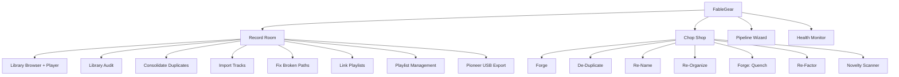

<div align="center">


# FableGear

**Local-first Rekordbox library toolkit for macOS**

### [Download FableGear for macOS](https://github.com/fabledharbinger0993/FableGear/releases/latest/download/FableGear.zip)


[](https://github.com/fabledharbinger0993/FableGear/actions/workflows/ci.yml)

**Free -- Open source (MIT) -- No account -- No cloud -- No telemetry**

</div>

---

## First launch on a Mac: two things macOS will ask you for

macOS protects you in two ways that you'll run into the first time you use FableGear. Both are normal, and neither means anything is wrong. Here's exactly where to click.

### 1. Open the installer the first time ("Install FableGear can't be opened")

FableGear isn't signed with an Apple Developer certificate, so macOS blocks a freshly downloaded copy until you approve it once.

1. **Double-click Install FableGear.app.** macOS shows a message that it can't verify the app. Click **Done** (or **OK**). Don't move it to the Trash.
2. Click the **Apple menu** (the apple logo in the top-left corner of your screen), choose **System Settings**, then click **Privacy & Security** in the left sidebar. You may need to scroll the sidebar down to find it.
3. Scroll down to the **Security** section. You'll see a message that FableGear was blocked. Click **Open Anyway**.
4. Enter your Mac's **login password** (or use Touch ID) and click **OK**. The installer opens, and you won't be asked again. (If macOS asks the same about FableGear itself the first time you open it from Applications, repeat these steps for it.)

> **Don't see Open Anyway?** The button only stays for about an hour after you try to open the app. If it's gone, double-click the app again, then go straight back to step 2.
>
> **On macOS 14 (Sonoma) or earlier,** you can also Control-click the app, choose **Open**, then click **Open** again. Newer macOS versions removed that shortcut, so use the steps above.

The installer is a normal window, not a Terminal. (Before you open it, install the prerequisites listed under [Install](#install).)

### 2. Let FableGear see your music and your Rekordbox library

macOS keeps some folders, external drives and Library files private until you allow an app to use them. FableGear needs access to wherever your music and Rekordbox database live.

- **When a pop-up asks**, such as *"FableGear would like to access files on a removable volume"* or *"...your Documents folder"*, click **Allow**. That's the easiest way.
- **If you clicked Don't Allow, or FableGear says it can't read a folder or drive**, fix it in System Settings:
  1. Open **System Settings → Privacy & Security**.
  2. Click **Files & Folders**. Find **FableGear** in the list and turn on the locations it needs, such as **Removable Volumes** for external drives like a USB stick or a portable hard drive.
- **If FableGear can't read your Rekordbox database**, its setup screen shows a *"Full Disk Access may be required"* notice with an **Open Settings** button. That takes you to **Privacy & Security → Full Disk Access**. Switch on **FableGear**.
- **Quit and reopen FableGear** after changing any of these. macOS only applies the new permission to an app the next time it starts.

You can change any of this later in the same place. Turning access off simply stops FableGear from seeing that location.

---

## What is FableGear?

FableGear is a desktop app for DJs who use Rekordbox. It gives you tools to clean up, repair, and manage your music library that go beyond what Rekordbox offers on its own.

Everything runs on your Mac. There is no cloud service, no login, and no data leaves your machine. FableGear reads and writes your Rekordbox database and audio files directly, so you stay in full control of your collection.

---

## How it is organized

FableGear has two main workspaces. **Record Room** handles everything tied to your Rekordbox database -- browsing tracks, managing playlists, fixing broken paths. **Chop Shop** works on your actual audio files -- tagging, deduping, normalizing loudness, renaming, converting formats.



---

## Record Room -- Rekordbox database tools

These tools read from and write to your Rekordbox database.

| Tool | What it does |
|---|---|
| **Library Browser + Player** | Browse your tracks with BPM, key, duration, and file path. Play tracks with waveform display. Split-view browsing of your filesystem alongside database entries. |
| **Library Audit** | Scans your Rekordbox database against your actual drives. Finds broken paths, orphaned entries, missing files, and tracks with no BPM or key tags. |
| **Consolidate Duplicates** | Finds DjmdContent records that are duplicates *in the database* -- same artist, title, and duration, but disputing file paths -- and merges them. Re-wires every playlist onto the surviving record first, then removes the redundant one. Never reads, moves, or deletes an audio file. See [Physical vs. database duplicates](#physical-vs-database-duplicates) below. |
| **Import Tracks** | Adds new audio files to Rekordbox. Supports dry-run previews and creates a backup before any writes. |
| **Fix Broken Paths** | Bulk-updates file paths in the database when a drive remounts with a different name or files have been moved. |
| **Link Playlists** | Maps your folder structure to Rekordbox playlist names after imports or reorganizations. |
| **Playlist Management** | Create, rename, delete, and reorder playlists. Add and remove tracks. |
| **Pioneer USB Export** | Onto a **blank USB drive** (or one FableGear exported to before), writes a CDJ-ready library: `export.pdb` (the Device Library that CDJ-3000 firmware 3.2x and older players read), OneLibrary `exportLibrary.db` for newer players, the audio under `Contents/`, and ANLZ beat grids and waveforms per track under `PIONEER/USBANLZ/`. BPM and key come from FableGear's own analysis (Iron) where it has it, otherwise from Rekordbox. A drive Rekordbox exported to is never overwritten. Not yet confirmed on a physical deck: test on a spare stick and keep a Rekordbox-made stick at gigs until it is. (A drive holding FableGear's older `PIONEER/Master/master.db` layout still gets that layout, without analysis data.) |

---

## Chop Shop -- audio file tools

These tools work on your physical audio files, not the Rekordbox database.

| Tool | What it does |
|---|---|
| **Forge** | Runs FableGear's three in-house tools on a folder in one pass: **Iron** finds BPM and key, **Anvil** writes them into the file's tags, **Quench** levels loudness. Each step skips what the file already carries (existing BPM, existing key, loudness already at target), so a run is safe to repeat. BPM and key also go into the FableGear database, and so does Quench's loudness measurement (LUFS, true peak, and the gain it applied). This means the info survives even if you rebuild your Rekordbox database or use the files outside Rekordbox, and the Pioneer USB export carries Iron's BPM and key onto the stick. |
| **De-Duplicate** | Step 1 uses acoustic fingerprinting to detect the same recording even when the filenames, formats, or bitrates are different (not just a filename check -- it listens to the audio). Step 2 moves the extra copies into the `Duplicates` folder of your `FableGear Archive` (beside your library, skipped by every scan) and removes them from the FableGear database, after taking a savepoint of it. Nothing is deleted, the Undo screen can put files and entries back, and Rekordbox's own database is never touched. |
| **Re-Name** | Batch rename files using patterns or learned rules from example pairs. Shows you a preview before anything changes. |
| **Re-Organize** | Rebuilds your folder structure based on embedded metadata (artist, album, etc.). Handles album artist intelligently so featured artists don't create extra folders. |
| **Quench** (inside Forge) | Measures loudness (EBU R128) and re-encodes tracks that fall outside your target level, keeping container, bit depth, tags and cover art. It is the one Forge step that rewrites audio: Passive mode (the default) levels only files outside the target and asks once before it starts; set it to Off for a tag-only run. Each file is written to a temporary copy and checked before it replaces the original, which is kept as a `.bak` only until that swap succeeds, so keep your own backup of the drive. A preview plays before-and-after samples first. AAC/M4A is left alone. |
| **Re-Factor** | Re-encodes a folder of audio files into a target format (e.g., FLAC to AIFF, WAV to MP3). |
| **Novelty Scanner** | Scans another drive for tracks that are not already in your main library, based on acoustic fingerprints. Useful for finding new music across external drives or a friend's collection. |

> **A note on accuracy.** BPM detection is the strongest part of the analysis. Key detection is a best guess and is wrong noticeably more often, so spot-check keys before you rely on them for harmonic mixing.

---

## Physical vs. database duplicates

Most DJ software treats "duplicate" as one thing: two files on disk that sound the same. That's true as far as it goes, but Rekordbox's actual source of truth is its database, not your filesystem -- and the two can disagree. A track survives a drive migration with its old path still on record, gets re-imported from a new location, and now you have two `DjmdContent` rows for the same song. Neither Rekordbox's built-in duplicate finder nor most third-party tools distinguish this case from a real duplicate file, and deleting the wrong record silently drops the track from every playlist it was in -- with no warning.

FableGear treats these as two distinct problems, in two distinct tools:

- **De-Duplicate** (Chop Shop) is *physical library* dedup. The filesystem is the source of truth. It fingerprints the actual audio to find files that sound the same, regardless of tags or filenames, and removing one moves a real file to the Archive's `Duplicates` folder beside your library (never deleted).
- **Consolidate Duplicates** (Record Room) is *database library* dedup. The Rekordbox database is the source of truth. It groups `DjmdContent` records by artist, title, and duration and flags groups that disagree on file path -- including records whose file no longer resolves anywhere. It never fingerprints, reads, moves, or deletes a single audio file; it only decides which record survives.

Both tools share the same non-breaking rule: **a record is never removed until every playlist that referenced it has been re-wired to the record that's staying.** If FableGear can't tell which copy should win -- both paths resolve, or both are broken, with no other distinguishing signal -- it leaves the group for you to resolve by hand rather than guessing.

---

## Pipeline Wizard

The Pipeline Wizard lets you chain multiple Chop Shop tools into a single automated run. Instead of running each tool one at a time, you build a sequence and let it execute.

Two modes:

- **Auto mode** -- runs straight through every step
- **Confirm between steps** -- pauses after each step so you can review the results before continuing

At each pause you can re-do the step, skip it, or stop the pipeline entirely.

---

## Safety -- how FableGear protects your library

FableGear is built to be cautious. Writing to a Rekordbox database incorrectly can break your library, so every write operation has guardrails.

- **Rekordbox must be closed** before any write operation. FableGear checks for this.
- **Write actions require your explicit confirmation.** Nothing changes without you saying yes.
- **Dry-run and preview modes** are available wherever practical, so you can see what will happen before it happens.
- **Automatic backups** are created before destructive database operations.
- **Health Monitor** runs at startup and on demand, checking for risky conditions before you proceed.
- **FableGear only listens on your own Mac** (127.0.0.1). Nothing is exposed to your network unless you deliberately turn that on.

The Health Monitor looks for things like:

- Rekordbox still running during a write attempt
- iCloud or Dropbox syncing your library folder (this causes corruption)
- Suspicious database size changes
- Read-only volume mounts
- Backups stored on the same drive as the database
- Low disk space
- Symlinked database files

Findings are shown with severity levels. Safe auto-fixes are applied where appropriate.

---

## AI agent integration (MCP)

FableGear also runs as an [MCP](https://modelcontextprotocol.io) server, exposing its library-management tools directly to AI agents -- Claude Desktop, Cursor, Windsurf, VS Code Copilot, and anything else that speaks the open MCP standard. This lets an agent audit, tag, dedupe, or reorganize your library through natural-language requests without opening the FableGear window.

The same safety contract applies as everywhere else: write tools check that Rekordbox is closed before touching the database and refuse if it's running, and every write creates a timestamped backup first. Enable it from FableGear's Settings panel, or run `python3 mcp_server.py` directly (stdio by default; `--transport sse` for HTTP-based/multi-client setups).

---

## Install

1. Install the prerequisites first (see [Requirements](#requirements)): Python 3.11–3.13, `ffmpeg`, and `fpcalc` (from Chromaprint). FableGear never installs or changes system software like these for you.
2. Click **Download FableGear for macOS** at the top of this page and unzip the archive. You get **Install FableGear.app**.
3. Double-click it. macOS will block it the first time: follow [First launch on a Mac](#first-launch-on-a-mac-two-things-macos-will-ask-you-for) above.
4. The installer window checks your Mac, builds a private Python environment for FableGear, installs FableGear's packages into it, and puts **FableGear** in your Applications folder (or `~/Applications` if your account can't write to `/Applications`). FableGear's own files live in `~/Library/Application Support/FableGear`. If a prerequisite is missing, the installer tells you what to get and waits.
5. Open **FableGear** from Applications. The intro plays, then a short setup asks for the access FableGear needs. You can delete the installer afterwards.

**Updating:** download the newest FableGear.zip and run its installer again. It replaces FableGear's program files and keeps your library, settings and private environment.

**Installing from source?** After cloning the repository, run `python3 fablegear/installer_wizard.py` (or `bash fablegear/setup.sh` for a Terminal install). It does the same checks and builds the private environment at the root of the clone, with no files copied elsewhere.

**Repository layout.** `fablegear/` is the app and the only folder the installer ships. `dev/` holds tests, research docs, benchmark scripts and build inputs; none of it is installed. Run the tests with `python -m pytest dev/tests` after `pip install -r dev/requirements-dev.txt`.

---

## Requirements

- macOS Monterey 12.0 or later
- Apple Silicon or Intel Mac
- Internet connection for first-time setup (to install FableGear's Python packages)
- Rekordbox must be closed for any write operation

### Prerequisites (you install these yourself)

- **Python 3.11–3.13** (3.14 and newer aren't supported yet)
- **`ffmpeg`**: audio processing and format conversion
- **`fpcalc`** (part of **Chromaprint**): acoustic fingerprinting for duplicate detection

FableGear checks for all three and tells you what's missing; it never installs or updates them, and it never touches Homebrew. If you use Homebrew, one way to get them is `brew install ffmpeg chromaprint python@3.13`. Otherwise get Python from [python.org](https://www.python.org/downloads/), ffmpeg from [ffmpeg.org](https://ffmpeg.org), and Chromaprint from [acoustid.org](https://acoustid.org/chromaprint).

---

## Quick start

1. Install the [prerequisites](#prerequisites-you-install-these-yourself)
2. Download, then [approve and open the installer](#first-launch-on-a-mac-two-things-macos-will-ask-you-for) the first time
3. Let the installer finish, then open FableGear from Applications
4. Point it at your Rekordbox database and music root folder
5. Run **Library Audit** first -- always audit before changing anything
6. Review any health warnings before running write operations
7. Use dry-run and preview modes whenever they are available

For large or older libraries, a safe order of operations is:

```
Audit --> Fix paths --> De-Duplicate --> Forge (tag / quench) --> Re-Organize --> Import --> Relink playlists
```

---

## Under the hood

FableGear is a Flask app that runs a local server on port 5001 (on your own Mac only) and opens in a native macOS window via pywebview. The UI is vanilla HTML/CSS/JS -- no frontend framework.

Audio analysis, tag handling and loudness are built in-house: **Iron** (`fablegear/iron/`) detects BPM, key and beat positions, **Anvil** (`fablegear/anvil/`) reads and writes tags, and **Quench** (`fablegear/quench/`) measures and levels loudness on ffmpeg. The libraries below are used for everything else: mutagen still reads general metadata and is Anvil's fallback, librosa is still the fallback BPM/key detector and decodes some formats for waveforms. essentia was removed in v1.2.0 and is no longer installed.

| Library | Purpose |
|---|---|
| [pyrekordbox](https://github.com/dylanljones/pyrekordbox) | Read/write access to the Rekordbox SQLite database |
| [Chromaprint / fpcalc](https://acoustid.org/chromaprint) | Acoustic fingerprinting for duplicate detection |
| [ffmpeg](https://ffmpeg.org) | Audio decoding for Iron; `loudnorm` measurement and `volume` rewrite for Quench; format conversion for Re-Factor |
| [mutagen](https://mutagen.readthedocs.io) | Audio metadata (tag) fallback |
| [librosa](https://librosa.org) | Fallback BPM/key/beat analysis and waveform generation |
| [Flask](https://flask.palletsprojects.com) + [Waitress](https://docs.pylonsproject.org/projects/waitress) | Local application server |
| [pywebview](https://pywebview.flowrl.com) | Native desktop window wrapper |

---

## Built by

**Guthrie Entertainment LLC** -- Free and open source -- [github.com/fabledharbinger0993](https://github.com/fabledharbinger0993)
